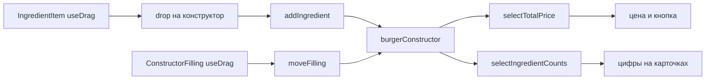
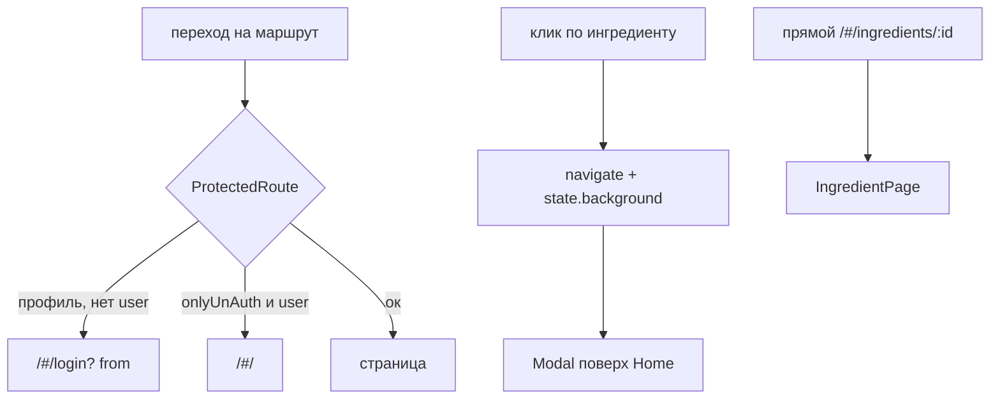
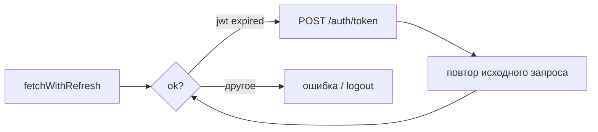
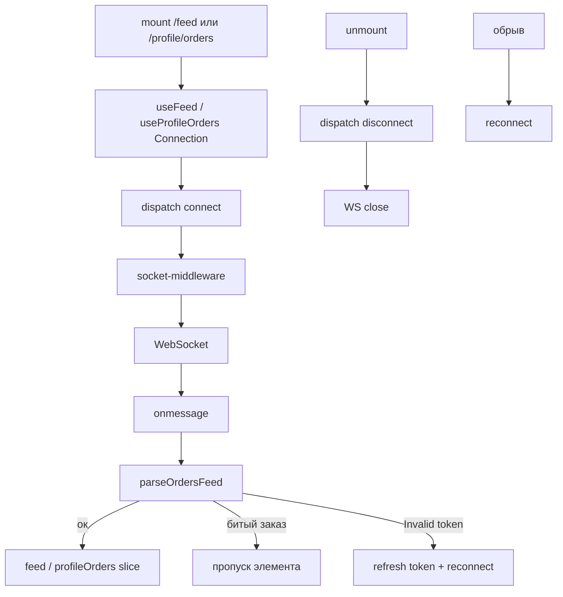
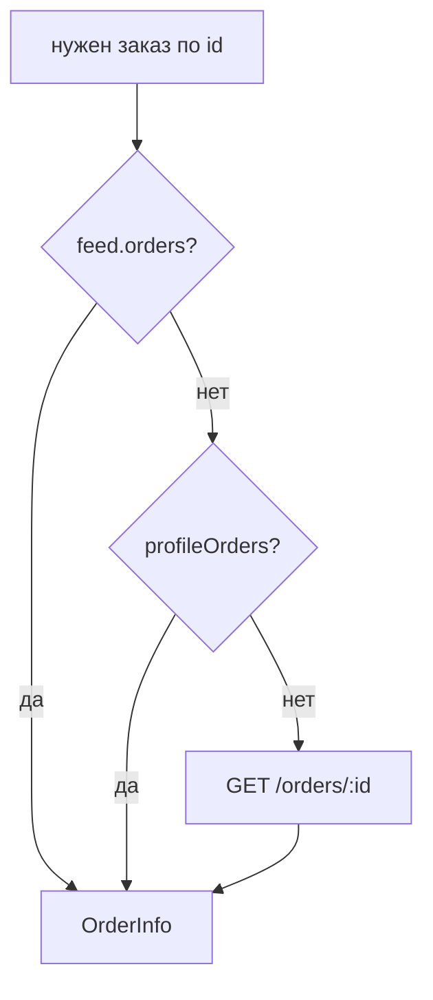
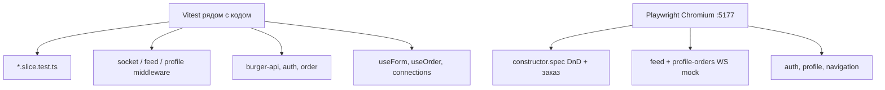
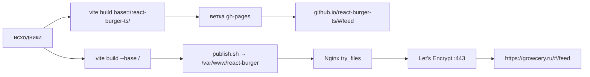

# Stellar Burgers

Клиентское React-приложение для заказа космических бургеров. Учебный проект курса «Middle Front-end + React».

## Стек

- React 19, TypeScript, Vite
- UI-kit [`@krgaa/react-developer-burger-ui-components`](https://react-burger-ui-components.education-services.ru/)
- Norma API: `https://new-stellarburgers.education-services.ru/api`

## Запуск

```bash
npm i
npm run dev
```

Сборка: `npm run build`. Превью продакшен-сборки: `npm run preview` (открыть путь `/react-burger-ts/`).

## Деплой

Сайт на GitHub Pages: https://kirillchistov.github.io/react-burger-ts/
Сайт на Yandex Cloud: https://growcery.ru/ (ВМ 153.51.163.30 / compute-vm-yc-middlereact-kirchistov)


```bash
npm run deploy
```

`predeploy` сначала делает `vite build`. Затем `gh-pages -d dist` публикует сборку в ветку `gh-pages`. В Settings → Pages: Source «Deploy from a branch», ветка `gh-pages`, папка `/ (root)`. Исходники остаются в основной ветке; после правок в коде — коммит туда, затем снова `npm run deploy`.

Скрипт собирает `dist` с `base: '/react-burger-ts/'` и публикует папку в ветку `gh-pages`. Клиентские маршруты идут через `HashRouter` (`#/profile`), поэтому GitHub Pages всегда отдаёт `index.html` и не отвечает 404 на вложенный путь.

### Nginx + Let's Encrypt (ВМ)

Прод: [https://growcery.ru/](https://growcery.ru/). Nginx на ВМ, сертификат Let's Encrypt для `growcery.ru` и `www.growcery.ru` (до 2027-02-11, автообновление `certbot.timer`). HTTP редиректит на HTTPS.

Конфиг SPA: [`deploy/nginx/react-burger.conf`](deploy/nginx/react-burger.conf) — `try_files $uri $uri/ /index.html`.

Сборка и выкладка статики из корня сайта (для Mac):

```bash
./deploy/publish.sh
```

### Маршрутизация:

- `HashRouter` + `Routes` / `Route` / `Navigate`. На GH Pages адрес вида `https://kirillchistov.github.io/react-burger-ts/#/profile`. Vite `base: '/react-burger-ts/'` задаёт пути к JS/CSS.
- Главная (`/`) собирает бургер; клик по ингредиенту открывает `/ingredients/:id` модалкой поверх главной (`location.state.background`) или отдельной страницей при прямом заходе.
- Гостевые страницы: `/login`, `/register`, `/forgot-password`, `/reset-password`. Профиль: `/profile` и `/profile/orders` через `Outlet`. Лента `/feed` получает заказы по `wss://.../orders/all`, пока страница открыта.
- Клик по заказу открывает `/feed/:id` или `/profile/orders/:id` модалкой поверх списка. В адресе — `_id` заказа: текущий API отдаёт заказ по нему, а не по номеру. Номер показывается в карточке как `#034535`.
- Неизвестные пути: страница 404 (заглушка).

### Авторизация:

- Токены `accessToken` и `refreshToken` хранятся в `localStorage`.
- Запросы с авторизацией идут через `fetchWithRefresh`: при `jwt expired` обновляется токен и повторяется исходный запрос.
- Заказ доступен только авторизованным пользователям.
- `ProtectedRoute` закрывает профиль для гостей и гостевые формы для авторизованных.
- Сброс пароля доступен только после успешного запроса с `/forgot-password`.

## Проверки перед коммитом

При создании коммита запускаются `stylelint`, `eslint` и `prettier`. Если линтер найдёт ошибки, коммит не создастся: исправьте замечания, затем снова `git add` и коммит.

Перед коммитом:

```bash
npm run lint
```

Отдельно:

- `npm run eslint` — ESLint с автоисправлениями
- `npm run stylelint` — Stylelint с автоисправлениями
- `npm run prettier` — форматирование

Для коммита по [Conventional Commits](https://www.conventionalcommits.org/en/v1.0.0/) лучше использовать `npm run commit`.

## Алиасы импорта

```
@          → src
@components → src/components
@pages      → src/pages
@services   → src/services
@utils      → src/utils
@hooks      → src/hooks
```

## [Проект с задачами спринтов](https://github.com/users/kirillchistov/projects/12)
## [Спринт 1]():

- [x] Список ингредиентов с сервера, прелоадер и обработка ошибок
- [x] Конструктор с демо-составом, стоимостью и кастомным скроллом
- [x] Модальные окна деталей ингредиента и оформленного заказа (портал, Esc, оверлей)

## Спринт 2:

- [x] Доработка интерфейса навигации по ингредиентам
- [x] Перенос получения массива ингредиентов в Redux
- [x] Перенос состояния модального окна выбора ингредиента в Redux
- [x] Запрос на создание заказа
- [x] Создание первых экшенов и редьюсеров
- [x] Реализация перетаскивания ингредиентов
- [x] Удаление ингредиентов из конструктора
- [x] Вложенная сортировка ингредиентов в конструкторе
- [x] Подсчёт количества добавленных ингредиентов
- [x] Подсчёт общей стоимости заказа

## Спринт 3:

- [x] Базовая настройка приложения (роутинг)
- [x] Доработка модального окна с информацией о выбранном ингредиенте
- [x] Вёрстка страниц и добавление маршрутов
- [x] Доработка главного меню приложения
- [x] Авторизация и регистрация
- [x] Восстановление и сброс пароля
- [x] Защищённые маршруты
- [x] Доработка профиля пользователя + кастомный хук useForm

## Спринт 4:

- [x] Сборка и запуск проекта, функционал прошлых спринтов работают без ошибок.
- [x] В проекте есть /components : App, AppHeader, BurgerIngredients, BurgerConstructor, Modal, ModalOverlay, OrderDetails, IngredientDetails;
- [x] В проекте есть /services : исходный массив ингредиентов, конструктор бургера, создание заказа, выбор ингредиента) с экшенами и слайсами или API (для RTK Query);
- [x] В проекте есть pages со всеми страницами, README.md, .gitignore.
- [x] Асинхронные экшены размещены в отдельном файле (не вместе со слайсом).
- [x] Стили портированы как модули. Общие стили портированы в глобальную область видимости.
- [x] Код оформлен без ошибок
- [x] Используется корректная система именования для переменных, функций, классов, компонентов, переменных и пр.
- [x] Корректно выполняются запросы к API
- [x] Разметка React портирована в JSX, заключена в ( ), вынесена в соответствующие ей компоненты.
- [x] Компоненты написаны корректно (хуки вне условных блоков, вызываются в основной функции компонента).
- [x] Типизация сконфигурирована и реализована корректно для компонентов, стора и пр.
- [x] Унифицировать состояние маршрута
- [x] Унифицировать ввода пароле на профиле (как в signin/signup)
- [x] Унифицировать загрузку восстановления пароля (authSlice)
- [x] Пофиксить UX модалки (фокус на кнопку закрытия)
- [x] Покрыть тестами редьюсер конструктора

## Спринт 5:

- [x] Экраны «Лента заказов» и «История заказов»: `/feed`, `/feed/:id`, `/profile/orders`, `/profile/orders/:id`. Клик открывает модалку поверх списка, прямой заход и обновление страницы — отдельную страницу. Если заказа нет в открытой ленте, он запрашивается `GET /orders/:id`.
- [x] Функциональность экрана «Лента заказов»: сокет `orders/all` подменяет список целиком. Стоимость считается по ингредиентам, `total` и `totalToday` приходят с сервера, колонки «Готовы» и «В работе» — по `status`. Соединение закрывается при уходе со страницы и открывается снова после разрыва.
- [x] Функциональность экрана «История заказов»: сокет `orders?token=` без префикса `Bearer`. Статусы «Создан», «Готовится» и «Выполнен» берутся из `status`, стоимость считается по ингредиентам. Устаревший токен обновляется и соединение открывается снова.
- [x] Сокеты: generic middleware и два middleware лент. Соединение закрывается при уходе со страницы, после обрыва открывается снова, некорректный заказ в сообщении пропускается.

## Спринт 6:

- [x] Покрыть тестами бизнес-логику приложения (все редьюсеры / слайсы, начальное состояние хранилища и все обработчики). Использовать Vitest.
- [x] Настроить интеграционное тестирование с Playwright (полноценный тест всего пути пользователя для функциональности страницы «Конструктор»: перетаскивание ингредиента, создание заказа, работу модальных окон на странице «Конструктор»).
- [x] Деплой приложения (получить грант на Yandex Cloud и токен для доступа к сервису, чтобы зарегистрировать [домен](https://growcery.ru/); [cоздать ВМ в Yandex Cloud](https://console.yandex.cloud/folders/b1ghuskffgfsavvpcuuj/compute/instances) или [Github Pages](https://kirillchistov.github.io/react-burger-ts/), разместить фронтенд-часть приложения Stellar Burgers, добавить ссылку на деплой в README проекта)
- Доработки по мотивам ревью:
- [x] Проверить работу юнит-тестов - [у ревьюера не проходят из-за localStorage](https://yadi.sk/i/iC_uKqBuNN0Qdw) 
- [x] Реализовать модели объектов страницы [POM](https://playwright.help/docs/pom), чтобы вынести повторяющуюся логику в отдельный класс и сделать код еще чище.

## Ретроспектива спринтов 1–6

Разбор Stellar Burgers по задачам брифа. Без тайминга: колонки — что сделано, где смотреть код и как показать результат.

Обзор: [`project-overview.md`](./project-overview.md). Тесты: [`project-testing.md`](./project-testing.md).

**Как открыть UI:** `npm run dev` → `http://localhost:5173/#/…` (`HashRouter`). Прод: [https://growcery.ru/](https://growcery.ru/), [GH Pages](https://kirillchistov.github.io/react-burger-ts/).  
**Терминал:** `npx vitest run`, `npm run e2e` (Playwright поднимает Vite на `:5177`).

---

## Спринт 1 — каталог, конструктор, модалки

| Спринт | Задача | Кратко: функционал | Код (файлы) | UI или терминал | Важные заметки |
| --- | --- | --- | --- | --- | --- |
| 1 | Список ингредиентов | `GET /ingredients`, прелоадер, ошибка на экране | [`burger-api.ts`](../src/utils/burger-api.ts), [`constants.ts`](../src/utils/constants.ts), [`home.tsx`](../src/pages/home/home.tsx), [`burger-ingredients.tsx`](../src/components/burger-ingredients/burger-ingredients.tsx) | `/#/` — три секции, Network → `/api/ingredients` | URL домена в константе; `checkResponse` + `catch` |
| 1 | Конструктор | Булка + начинки, цена, кастомный скролл списка | [`burger-constructor.tsx`](../src/components/burger-constructor/burger-constructor.tsx) | `/#/` правая колонка | Скролл только начинок, не всей колонки |
| 1 | Модалки | Портал в `#modals`, Esc, клик по оверлею | [`modal.tsx`](../src/components/modal/modal.tsx), [`modal-overlay.tsx`](../src/components/modal-overlay/modal-overlay.tsx), [`ingredient-details.tsx`](../src/components/ingredient-details/ingredient-details.tsx), [`order-details.tsx`](../src/components/order-details/order-details.tsx), [`index.html`](../index.html) | Клик по карточке / «Оформить заказ» | Overlay **без** `children`; фокус на кнопке закрытия (S4) |

---

## Спринт 2 — Redux и DnD

| Спринт | Задача | Кратко: функционал | Код (файлы) | UI или терминал | Важные заметки |
| --- | --- | --- | --- | --- | --- |
| 2 | Навигация по вкладкам | Табы Булки/Соусы/Начинки, подсветка по скроллу | [`burger-ingredients.tsx`](../src/components/burger-ingredients/burger-ingredients.tsx) | Скролл каталога — активный таб меняется | Intersection / ближайший заголовок |
| 2 | Ингредиенты в Redux | Загрузка массива через thunk, не в `App` state | [`ingredients-slice.ts`](../src/services/ingredients/ingredients-slice.ts), [`ingredients-actions.ts`](../src/services/ingredients/ingredients-actions.ts) | Redux DevTools (только `DEV`) → `ingredients` | Thunk **отдельно** от слайса |
| 2 | Модалка ингредиента в Redux | `set` / `clear` выбранного ингредиента | [`current-ingredient-slice.ts`](../src/services/current-ingredient/current-ingredient-slice.ts) | После S3 клик пишет маршрут, слайс остаётся | Клик больше не обязан писать в слайс |
| 2 | Создание заказа | `POST /orders`, модалка с номером | [`order-slice.ts`](../src/services/order/order-slice.ts), [`order-actions.ts`](../src/services/order/order-actions.ts) | «Оформить заказ» | С S3 заказ только с JWT |
| 2 | Первые экшены и редьюсеры | Store, `combineSlices`, селекторы в слайсах | [`store.ts`](../src/services/store.ts), [`hooks.ts`](../src/services/hooks.ts) | DevTools: дерево слайсов | DevTools выключены в production |
| 2 | DnD в конструктор | Булка заменяется, начинка добавляется с uuid | [`dnd.ts`](../src/utils/dnd.ts), [`ingredient-item.tsx`](../src/components/ingredient-item/ingredient-item.tsx), [`home.tsx`](../src/pages/home/home.tsx) | Перетащить булку, затем начинку | HTML5 backend |
| 2 | Удаление начинки | Крестик снимает позицию | [`constructor-filling.tsx`](../src/components/burger-constructor/constructor-filling.tsx) | Hover начинки → удалить | Булку крестиком не снимаем |
| 2 | Сортировка начинок | DnD внутри списка начинок | [`constructor-filling.tsx`](../src/components/burger-constructor/constructor-filling.tsx), [`burger-constructor-slice.ts`](../src/services/burger-constructor/burger-constructor-slice.ts) | Переставить две начинки | uuid стабилен при сортировке |
| 2 | Счётчики | Число на карточке: булка = 2, начинка = count | селекторы в [`burger-constructor-slice.ts`](../src/services/burger-constructor/burger-constructor-slice.ts) | Карточка после drop | `createSelector` |
| 2 | Стоимость | Сумма булки×2 + начинки | тот же слайс | Нижняя панель конструктора | Мемоизация, не считать в UI |



---

## Спринт 3 — маршруты и авторизация

| Спринт | Задача | Кратко: функционал | Код (файлы) | UI или терминал | Важные заметки |
| --- | --- | --- | --- | --- | --- |
| 3 | Роутинг | `HashRouter`, `Routes`, `pages/` | [`main.tsx`](../src/main.tsx), [`app.tsx`](../src/components/app/app.tsx), [`constants.ts`](../src/utils/constants.ts) `ROUTES` | Адреса вида `/#/login` | Hash — чтобы GH Pages не отдавал 404 |
| 3 | Ингредиент: модалка и страница | Клик — модалка + `background`; прямой заход — страница | [`app.tsx`](../src/components/app/app.tsx), [`ingredient-page.tsx`](../src/pages/ingredient/ingredient-page.tsx) | Клик с главной vs вставить `/#/ingredients/:id` | `location.state.background` |
| 3 | Страницы и маршруты | login, register, forgot, reset, profile, feed, 404 | [`src/pages/`](../src/pages/) | Шапка → каждый пункт | `/feed` до S5 был заглушкой |
| 3 | Меню | `NavLink` Конструктор / Лента / Личный кабинет | [`app-header.tsx`](../src/components/app-header/app-header.tsx) | Активный пункт подсвечен | Лента доступна всем |
| 3 | Login / register | `POST /auth/login`, `/auth/register`, токены в storage | [`auth-actions.ts`](../src/services/auth/auth-actions.ts), [`login-page.tsx`](../src/pages/login/login-page.tsx), [`register-page.tsx`](../src/pages/register/register-page.tsx) | `/#/login`, `/#/register` | После входа — `from` или `/` |
| 3 | Forgot / reset | Письмо, затем сброс только с флагом | [`forgot-password-page.tsx`](../src/pages/forgot-password/forgot-password-page.tsx), [`reset-password-page.tsx`](../src/pages/reset-password/reset-password-page.tsx), [`auth.ts`](../src/utils/auth.ts) | `/#/forgot-password` → `/#/reset-password` | Без флага reset → forgot |
| 3 | ProtectedRoute | Профиль только auth; формы — `onlyUnAuth` | [`protected-route.tsx`](../src/components/protected-route/protected-route.tsx) | Гость на `/#/profile` → login | Сохраняет `from` |
| 3 | Профиль + `useForm` | Имя/email/пароль, save `PATCH`, cancel, logout | [`profile-page.tsx`](../src/pages/profile/profile-page.tsx), [`useForm.ts`](../src/hooks/useForm.ts) | `/#/profile` | Один хук на все формы |





---

## Спринт 4 — качество, унификация, первый тест

| Спринт | Задача | Кратко: функционал | Код (файлы) | UI или терминал | Важные заметки |
| --- | --- | --- | --- | --- | --- |
| 4 | Сборка и структура | `components`, `services` по фичам, `pages`, README, `.gitignore` | дерево `src/`, [`README.md`](../README.md) | `npm run build`, `npm run dev` | Чек-лист: прошлые спринты не сломаны |
| 4 | Стили и код | CSS Modules, глобальные утилиты, нейминг, JSX в `( )` | `*.module.css`, [`index.css`](../src/index.css) | `npm run lint` | Хуки не в условиях |
| 4 | Типизация | Пропсы, стор, `useAppDispatch` / `useAppSelector` | [`store.ts`](../src/services/store.ts), [`hooks.ts`](../src/services/hooks.ts) | `npx tsc --noEmit` / Vite checker | Без лишнего `any` |
| 4 | Унификация UX | Состояние маршрута; пароль в профиле как в login; loading forgot в `authSlice`; фокус закрытия модалки | [`profile-page.tsx`](../src/pages/profile/profile-page.tsx), [`auth-slice.ts`](../src/services/auth/auth-slice.ts), [`modal.tsx`](../src/components/modal/modal.tsx) | Профиль: иконка глаза; Tab → крестик модалки | Ревью S3 |
| 4 | Тест конструктора | Редьюсер: add / move / delete / clear / цена | [`burger-constructor-slice.test.ts`](../src/services/burger-constructor/burger-constructor-slice.test.ts) | `npx vitest run src/services/burger-constructor` | База для S6 |

---

## Спринт 5 — ленты заказов и WebSocket

| Спринт | Задача | Кратко: функционал | Код (файлы) | UI или терминал | Важные заметки |
| --- | --- | --- | --- | --- | --- |
| 5 | Экраны ленты и истории | `/feed`, `/feed/:id`, `/profile/orders`, `/profile/orders/:id`; клик — модалка, прямой заход — страница | [`feed-page.tsx`](../src/pages/feed/feed-page.tsx), [`profile-orders-page.tsx`](../src/pages/profile/profile-orders-page.tsx), [`order-page.tsx`](../src/pages/order/order-page.tsx), [`order-card.tsx`](../src/components/order-card/order-card.tsx), [`order-info.tsx`](../src/components/order-info/order-info.tsx) | `/#/feed`, `/#/profile/orders` | В URL `_id`, на карточке номер `#034535` |
| 5 | Лента | Сокет подменяет список; цена из ингредиентов; `total` / `totalToday`; колонки Готовы / В работе | [`feed-slice.ts`](../src/services/feed/feed-slice.ts), [`order-stats.tsx`](../src/components/order-stats/order-stats.tsx), [`useFeedConnection.ts`](../src/hooks/useFeedConnection.ts) | `/#/feed` → Network WS `orders/all` | Не больше 10 номеров в колонке, иначе ещё колонка |
| 5 | История | Только auth; статусы Создан / Готовится / Выполнен; токен в query | [`profile-orders-slice.ts`](../src/services/profile-orders/profile-orders-slice.ts), [`useProfileOrdersConnection.ts`](../src/hooks/useProfileOrdersConnection.ts) | Залогиниться → `/#/profile/orders` | `?token=` **без** `Bearer` |
| 5 | Сокеты | Generic middleware + два экземпляра; close при уходе; reconnect; пропуск битого заказа | [`socket-middleware.ts`](../src/services/socket/socket-middleware.ts), [`feed-middleware.ts`](../src/services/feed/feed-middleware.ts), [`profile-orders-middleware.ts`](../src/services/profile-orders/profile-orders-middleware.ts), [`order.ts`](../src/utils/order.ts) | Уйти со `/#/feed` — WS закрывается | `parseOrdersFeed` ждёт `success`, `orders`, `total`, `totalToday` |
| 5 | Детали заказа | Кэш ленты → мок → `GET /orders/:id` | [`useOrder.ts`](../src/hooks/useOrder.ts) | Открыть `/#/feed/:id` которого нет в списке | Нужен, потому что сокет отдаёт ~50 заказов |





---

## Спринт 6 — тесты и деплой

| Спринт | Задача | Кратко: функционал | Код (файлы) | UI или терминал | Важные заметки |
| --- | --- | --- | --- | --- | --- |
| 6 | Vitest: бизнес-логика | Все слайсы: initial + обработчики; middleware; `burger-api`, `auth`, `order`; хуки; RTL `ProtectedRoute` | `src/services/**/*.test.ts`, [`burger-api.test.ts`](../src/utils/burger-api.test.ts), [`protected-route.test.tsx`](../src/components/protected-route/protected-route.test.tsx), [`project-testing.md`](./project-testing.md) | `npx vitest run` | Thunk в тесте — `pending`/`fulfilled`/`rejected`, без сети |
| 6 | Playwright: конструктор | DnD, заказ, модалки, счётчики, сортировка, удаление, disabled кнопки, прелоадер, ошибка | [`constructor.spec.ts`](../e2e/constructor.spec.ts), [`dnd.ts`](../e2e/helpers/dnd.ts), [`app.ts`](../e2e/helpers/app.ts) | `npm run e2e` — Chromium | `dragTo` HTML5 DnD не работает: свой `DragEvent`. Auth не внутри заказа: `seedAuth` |
| 6 | Playwright: остальные пути | Лента, история, login/register/reset, профиль, ingredient, 404, reset без флага | [`feed.spec.ts`](../e2e/feed.spec.ts), [`profile-orders.spec.ts`](../e2e/profile-orders.spec.ts), [`auth.spec.ts`](../e2e/auth.spec.ts), [`profile.spec.ts`](../e2e/profile.spec.ts), [`navigation.spec.ts`](../e2e/navigation.spec.ts) | `npm run e2e` | Маршруты `/#/feed`. Dev-server `:5177` |
| 6 | GitHub Pages | `HashRouter`, `base: '/react-burger-ts/'`, `gh-pages -d dist` | [`main.tsx`](../src/main.tsx), [`vite.config.ts`](../vite.config.ts), [`package.json`](../package.json) `predeploy`/`deploy` | [kirillchistov.github.io/react-burger-ts](https://kirillchistov.github.io/react-burger-ts/) | Settings → Pages: ветка `gh-pages`, `/ (root)` |
| 6 | Yandex Cloud + Nginx | ВМ, зона `growcery.ru`, SPA `try_files`, HTTPS Let's Encrypt | [`react-burger.conf`](../deploy/nginx/react-burger.conf), [`setup-nginx.sh`](../deploy/setup-nginx.sh), [`publish.sh`](../deploy/publish.sh) | [https://growcery.ru/](https://growcery.ru/) | `publish.sh` ходит по IP `153.51.163.30` (known_hosts). На ВМ `vite build --base /` |





---

## Как сделать демо

1. Конструктор: булка + начинка, счётчик, цена, сортировка, заказ (нужен логин) → модалка номера → конструктор пустой.
2. Ингредиент: модалка с главной, затем refresh на `/#/ingredients/:id` — уже страница.
3. Гость на `/#/profile` → login; `/#/reset-password` без forgot → forgot.
4. `/#/feed`: живые карточки, колонки, клик → модалка, в адресе `_id`.
5. `/#/profile/orders` после логина: статусы, сокет с `token=` в URL (DevTools).
6. Терминал: `npx vitest run` и `npm run e2e`.
7. Прод: замок на [growcery.ru](https://growcery.ru/) и тот же UI на GH Pages под `/react-burger-ts/#/`.
