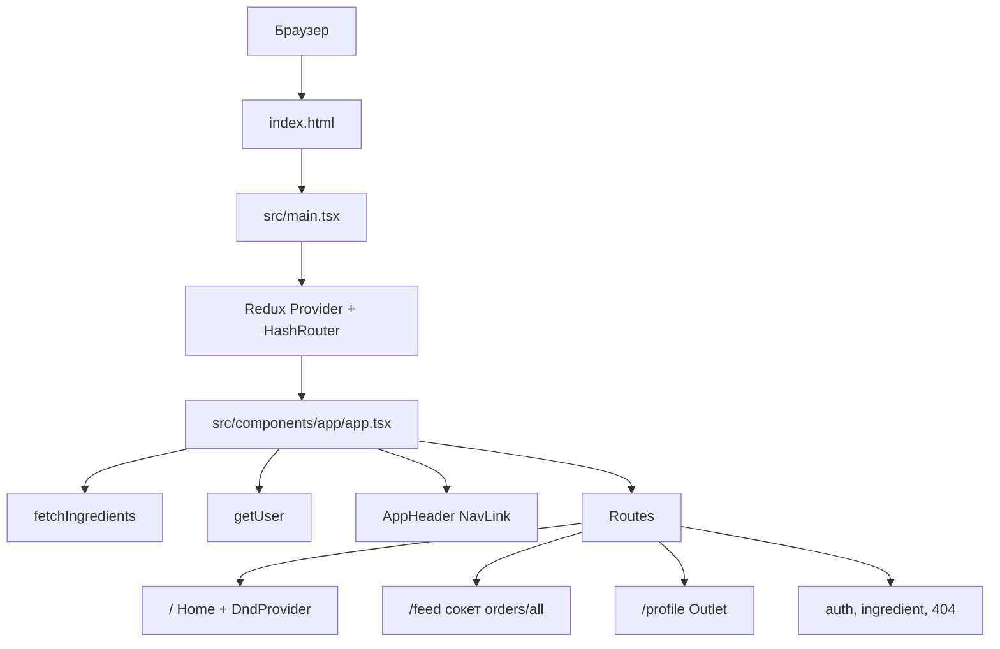
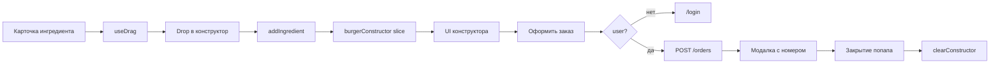
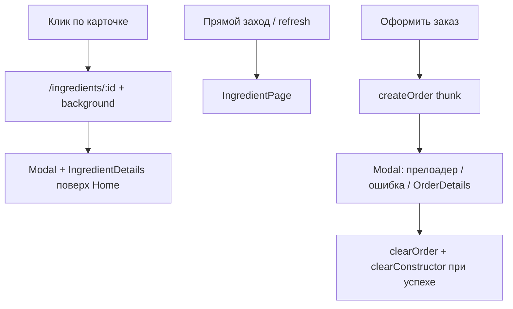
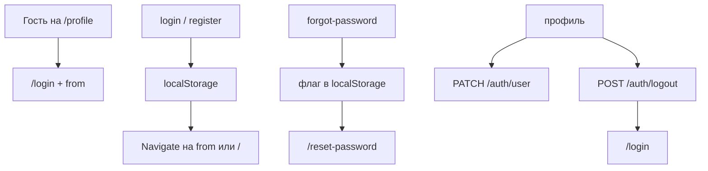
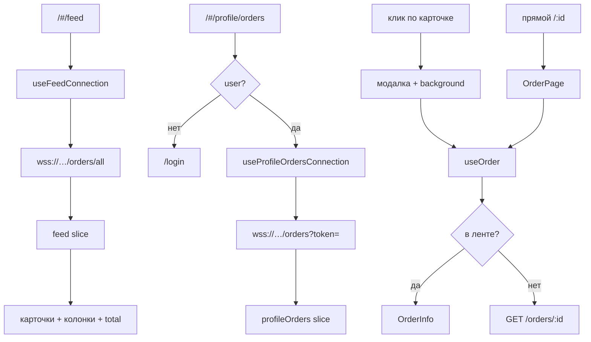

# Обзор проекта

Stellar Burgers — клиентское React-приложение для сборки бургера и оформления заказа.
Учебный проект курса «React-разработчик». Реализованы спринты 1–6. Собирается как Vite SPA.

> Схема: [`project-overview.svg`](./project-overview.svg)  
> Ретро по задачам: [`project-retro.md`](./project-retro.md)  
> Тесты: [`project-testing.md`](./project-testing.md)  
> Архитектура: [`project-architecture.md`](./project-architecture.md)

Брифы и чек-листы: [1](./checklist-1.md), [2](./checklist-2.md) / [sprint2](./sprint2.md), [3](./checklist-3.md) / [sprint3](./sprint3.md), [4](./checklist-4.md), [5](./checklist-5.md) / [overview-s5](./project-overview-s5.md).

## Что делает приложение

- Загружает ингредиенты из Norma API (`GET /ingredients`).
- Показывает каталог с вкладками «Булки / Соусы / Начинки» и подсветкой ближайшего заголовка при скролле.
- Позволяет собрать бургер drag-and-drop: булка заменяется, начинки добавляются, сортируются и удаляются.
- Считает стоимость и счётчики на карточках мемоизированными селекторами.
- Оформляет заказ (`POST /orders` с `authorization`) только у авторизованного пользователя и показывает номер в модалке. Тело: `[bunId, ...fillingIds, bunId]`. После закрытия попапа очищает конструктор.
- Маршрутизирует экраны через `HashRouter`: главная, ингредиент, auth-формы, профиль, лента, история заказов и 404.
- Хранит JWT в `localStorage`, обновляет access-токен через `fetchWithRefresh`.
- Показывает живую ленту `/feed` по `wss://…/orders/all` и историю `/profile/orders` по `wss://…/orders?token=` (токен без `Bearer`).
- Клик по заказу открывает модалку поверх списка; прямой заход и refresh — страницу. Если заказа нет в кэше ленты — `GET /orders/:id`.
- Покрыт Vitest (слайсы, middleware, API, хуки) и Playwright (конструктор, лента, профиль, auth, навигация).
- Задеплоен на GitHub Pages и на ВМ Яндекс.Облака за Nginx + Let's Encrypt.

## Верхнеуровневая структура

```text
.
├── docs/                     # Задания, чек-листы, обзор, ретро, схемы
├── deploy/                   # Nginx, setup-nginx.sh, publish.sh
├── e2e/                      # Playwright: сценарии, хелперы, фикстуры
├── public/                   # Статические файлы Vite
├── src/
│   ├── components/           # UI: шапка, конструктор, модалки, карточки заказов
│   ├── pages/                # Страницы маршрутов
│   ├── hooks/                # useForm, useOrder, подключение сокетов
│   ├── services/             # Redux: store, слайсы, thunks, socket middleware
│   └── utils/                # API, auth storage, константы, типы, DnD
├── index.html                # HTML-оболочка, узел #modals
├── vite.config.ts            # Vite, алиасы, Vitest, base для GH Pages
└── package.json              # Скрипты и зависимости
```

## Поток запуска



## Основные пользовательские потоки

### Конструктор бургера



### Ингредиент и модалки



### Auth и профиль



### Лента и история заказов



## Источники данных

| Источник | Для чего используется | Основные файлы |
| --- | --- | --- |
| REST API | Ингредиенты, заказ, register/login/logout/token/user, сброс пароля, `GET /orders/:id` | `src/utils/burger-api.ts`, `src/utils/constants.ts` |
| WebSocket | Живая лента `orders/all`, история `orders?token=` | `src/services/socket/socket-middleware.ts`, `feed-middleware.ts`, `profile-orders-middleware.ts` |
| localStorage | `accessToken`, `refreshToken`, флаг reset-password | `src/utils/auth.ts` |
| Redux store | Auth, ингредиенты, конструктор, текущий ингредиент, заказ, лента, история | `src/services/store.ts`, слайсы в `src/services/*` |
| React Router | Экраны, модальный фон, protected routes | `src/main.tsx`, `src/components/app/app.tsx` |
| React DnD | Перетаскивание в конструктор и сортировка начинок | `src/utils/dnd.ts`, `src/pages/home/home.tsx` |

## Важные замечания по текущей реализации

- CSR SPA. `HashRouter` (`#/profile`). Vite `base: '/react-burger-ts/'` только в production-сборке для GH Pages; на ВМ публикуется `vite build --base /`.
- Заказ только с авторизацией. Тело: `[bunId, ...fillingIds, bunId]`.
- `fetchWithRefresh`: при `jwt expired` — `POST /auth/token`, повтор исходного запроса.
- Профильный сокет: query `?token=` без префикса `Bearer`. Невалидный токен — refresh и новое соединение.
- Redux DevTools включены только в `import.meta.env.DEV`. Overlay модалки без children.
- В адресе заказа — `_id`, не номер. Номер показывается в карточке как `#034535`.
- Деплой: [GitHub Pages](https://kirillchistov.github.io/react-burger-ts/) и [https://growcery.ru/](https://growcery.ru/) (Nginx + Let's Encrypt).

## Спринты

### Спринт 1

- [x] Список ингредиентов с сервера, прелоадер и обработка ошибок
- [x] Конструктор, стоимость, кастомный скролл
- [x] Модалки ингредиента и заказа (портал, Esc, оверлей)

### Спринт 2

- [x] Табы ингредиентов, Redux, заказ, DnD, счётчики и цена

### Спринт 3

- [x] Роутинг, страница и модалка ингредиента
- [x] Вёрстка login/register/forgot/reset/profile/feed/404
- [x] Auth API, `ProtectedRoute`, профиль save/cancel, заказ только с токеном, `useForm`

### Спринт 4

- [x] Сборка, структура `components` / `services` / `pages`, модульные стили, типизация
- [x] Thunks отдельно от слайсов, унификация профиля и модалки
- [x] Тесты редьюсера конструктора

### Спринт 5

- [x] Экраны ленты и истории: `/feed`, `/feed/:id`, `/profile/orders`, `/profile/orders/:id`
- [x] Сокеты: generic middleware и два middleware лент, reconnect, разбор сообщений

### Спринт 6

- [x] Vitest: все слайсы, middleware, утилиты, хуки, `ProtectedRoute`
- [x] Playwright: конструктор (DnD, заказ, модалки) и соседние пути
- [x] Деплой: GitHub Pages и ВМ Яндекс.Облака, Nginx, сертификат Let's Encrypt
